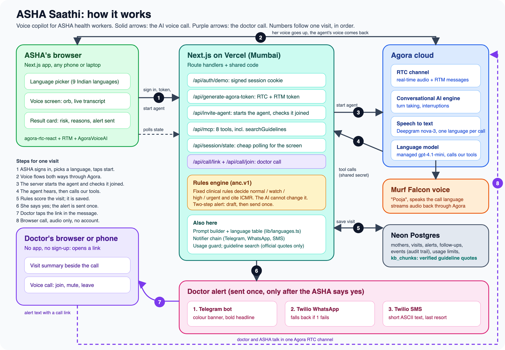

# ASHA Saathi

A voice assistant for ASHA health workers in India. After a home visit the ASHA talks to it in Hindi, Kannada or English. It records the visit, flags danger signs with fixed clinical rules, and alerts the doctor on WhatsApp after she says yes.

Built for **Build with Agora, Bengaluru (Track 5: Voice AI for Bharat)** on Agora Conversational AI, Murf Falcon text-to-speech, Next.js and Neon Postgres.

## How an ASHA uses it

1. Open the app and tap the orange orb. No sign-up.
2. Say who you visited and what you found: *"Sunita ji ke ghar gayi thi, saat mahine, BP 150 by 100, pairon mein sujan."*
3. Saathi finds the mother, saves the visit and says the risk level and the main reason out loud.
4. For high risk it asks *"Doctor ko alert bhejoon?"* Say *haan* and one WhatsApp message goes to the doctor. Saying it twice never sends two.
5. Saathi books the follow-up visit. `Aaj ka kaam batao` lists what is left today.

The screen shows the same thing the voice says: the saved visit, risk, the rule behind it, the alert and the follow-up. `/dashboard` is a read-only projector view of the live activity.

## How it works

```
Browser (mic + speaker) ── Agora RTC ──> Agora Conversational AI
                                          ├─ speech recognition (Deepgram, Agora-managed)
                                          ├─ language model     (gpt-4o-mini, Agora-managed)
                                          └─ voice              (Murf Falcon, our key)
                                              │  the model calls our tools over MCP
                                              ▼
                  Vercel (this app) /api/mcp ── tools ── Neon Postgres
                       │                          └── risk rules (lib/rules/anc.v1.ts)
                       └── /api/session/state, /api/dashboard  → screens read live data
```

Why it is built this way:

- **The AI never decides risk.** `recordVisit` runs a deterministic, unit-tested rules function. The model only listens, speaks and calls tools. It cannot change a risk level. `amendLastVisit` fixes a wrongly recorded value on the visit saved in the current call and re-runs the same rules.
- **Two-step alerts.** `draftAlert` prepares the message and sends nothing. `sendAlert` needs the confirmation token, works once (atomic database claim), expires after 10 minutes and can be retried if delivery fails.
- **Every number is validated.** Tool inputs are checked with zod, so a speech-recognition slip like BP 999 is rejected instead of saved.
- **Everything is observable.** Each tool call is stored with its timing and shown in the dashboard timeline.
- **Tools never throw.** A failure becomes a plain message the agent can say.

## Alerts: how delivery works

`NOTIFIER=multi` tries **Telegram first, then WhatsApp, then SMS**. Telegram has no join step and no 24-hour window (create a bot with @BotFather, tap Start in it, run `pnpm telegram:setup`). `NOTIFIER=twilio` skips Telegram. The Twilio part tries WhatsApp first, then SMS from your Twilio number. Twilio accepts a WhatsApp message and only afterwards reports that the phone has not joined the sandbox (error 63015), so the notifier watches the status for about 3 seconds and falls through to SMS. SMS uses a short ASCII text (`sms_text`), because trial accounts reject long SMS (error 30044). The screen and the dashboard show the channel that actually delivered. Verified on production: spoken yes, one alert, delivered by SMS. WhatsApp works once the doctor's phone sends the sandbox join phrase.

`pnpm alerts:test` sends one real test message through the chain (`--channel telegram|whatsapp|sms` to force one).

## Evidence and honest limits

Rule thresholds come from the official documents we hold. See `knowledge/RULES_EVIDENCE.md` for the verbatim quotes and page numbers (ICMR STW, NHM CHO booklet, PMSMA).

- **Cited** (quoted from ICMR STW page 1): BP above 140/90, Hb below 7, age under 19 or over 35, parity above 4, and the danger signs bleeding, convulsion, severe headache, blurred vision, reduced baby movement, fever, persistent vomiting, breathlessness and leaking fluid.
- **Not in those documents, so shown without a source** (`pending` in `lib/rules/anc.v1.ts`): the 160/110 severe-BP level, anaemia below 11, and swelling of face or hands. The app never shows a citation for these.
- **Product decisions a clinician should review:** the ICMR criterion is two BP readings 6 hours apart; we flag a single reading of 140/90 or more as high and tell the ASHA to repeat it after 6 hours. We treat 140 or 90 as the cut-off (the source writes "greater than"). Which danger signs are "urgent" rather than "high" is our mapping.
- Saathi gives **decision support and referral, never a diagnosis**. Guideline Q&A (advice for the family) is not built yet, so it declines to give medical advice from memory.

## Data and privacy

- Stores: ASHAs, registered mothers (name, village, age, parity, last period), visits, alerts, follow-ups and tool-call events, all in your Neon database.
- **Demo sign-in, no passwords.** `/login` has one button, "Continue as demo ASHA". It creates a private copy of the seeded ASHA and her six mothers for that visitor and sets a signed, HttpOnly cookie. Visitors never see each other's data, and demo accounts are deleted after 24 hours. The app, the token route, the agent start route and the call-state route all require this session, and the ASHA is taken from the session, never from the request.
- **Usage guard.** Agent starts are capped per visitor, per IP and per day (`AGENT_STARTS_PER_ASHA_HOUR`, `AGENT_STARTS_PER_IP_HOUR`, `AGENT_STARTS_PER_DAY`) and a call ends by itself after 12 minutes, so the free 300 agent-minutes cannot be burned by one person.
- Real accounts for health workers (phone OTP or a code issued by the health centre) are not built yet.
- `/dashboard` shows real patient data. **Set `DASHBOARD_KEY` in production** and open `/dashboard?key=...`.
- Use made-up data in demos. Do not seed real patients without proper consent and access control.

## Architecture



Source: [docs/architecture.svg](docs/architecture.svg).

## Guideline answers

Health advice comes only from official Government of India documents (MoHFW, NHM, ICMR). Their verbatim quotes live in `knowledge/` and are loaded into the `kb_chunks` table. During a call the agent calls the `searchGuidelines` tool, answers in one or two sentences, and names the source ("according to the MoHFW guideline"). If nothing matches, it says it does not have the information and refers her to the ANM or Medical Officer. It never answers health questions from memory, never gives doses, and refuses off-topic requests, attempts to read its instructions, and requests for other people's data.

```bash
pnpm db:migrate && pnpm kb:ingest   # once, and after any knowledge change
pnpm kb:verify                      # proves every quote is on its cited page of the official PDF
pnpm kb:check                       # retrieval regression: right passage found, off-topic refused
```

See [knowledge/README.md](knowledge/README.md) for the quote rules and the update steps (also available as the `kb-update` skill).

## Local testing

Sign-in, the screens and the tests work on `localhost`. The **voice agent does not**: Agora's cloud calls your tool server over the internet and rejects `localhost` ("URL host localhost is blocked"). To test a call from your machine set `PUBLIC_BASE_URL` in `.env.local` to either:

- your deployed site, e.g. `https://asha-saathi-mocha.vercel.app`. Tool calls then run on that deployment, so your local `MCP_SHARED_SECRET` and `DATABASE_URL` must match its values; or
- a tunnel to your local server (`cloudflared tunnel --url http://localhost:3000` or `ngrok http 3000`), which also tests your local tool code.

Restart `pnpm dev` after changing it. The app shows this advice instead of the raw Agora error.

## Voices

The start screen has a swipeable voice picker (cards you can swipe, tap, or step with the arrows). Each language lists its Murf Falcon voices in `lib/voices.ts`. "Pooja" (multilingual) is the default for Hindi, English, Kannada, Tamil and Telugu, where Murf lists it; Gujarati, Bengali, Marathi and Malayalam default to native voices because Pooja is not listed for them. The choice is remembered per language in the browser and sent as `voice` to `/api/invite-agent`, which only accepts a voice offered for that language (otherwise the default). `MURF_VOICE_ID` is no longer used. Picking a language or a voice plays a short spoken sample of it (a few seconds, moving bars on the card): the samples are static files in `public/voice-samples/`, made once with `pnpm voice:samples` (needs `MURF_API_KEY`; re-run it, with `--force` to redo, after changing the voice list or a greeting). `MURF_WS_URL` still overrides the Murf endpoint (default `wss://global.api.murf.ai/...`, which routes to the nearest region).

## Doctor call

For HIGH and URGENT visits the alert message carries a signed link (`/call/<token>`, valid 6 hours). The doctor taps it and joins a browser voice call with the ASHA over Agora RTC: no app, no account, audio only. The page shows the visit summary beside the call. The ASHA opens the same call from the "call doctor" button on the result card. Needs `PUBLIC_BASE_URL` set so the link is absolute.

## Languages

The whole interface (landing page, sign-in, start screen, call screen, result and alert cards) is written in nine languages: Hindi, English, Kannada, Tamil, Telugu, Gujarati, Bengali, Marathi and Malayalam. Pick one with the switcher in the landing page header or the language chips on the start screen; the choice is remembered in the browser and is also the call language. Auto keeps the last chosen interface language until it hears speech, then follows the script of what was spoken, and shows a rotating hello in every language while connecting. The texts are in `lib/i18n/` (English is the master; the compiler enforces that every language has every key) and were machine-written: **have native speakers review them**. Risk reasons from the rules engine and the alert text sent to the doctor stay in English by design.

Pick the call language on the start screen: Hindi, English, Kannada, Tamil, Telugu, Gujarati, Bengali, Marathi or Malayalam. The speech recogniser is set per call (Deepgram nova-3 with that language's code) and the agent speaks the same language with the Murf voice. **Why not automatic detection:** Deepgram's multi mode mis-heard accented English as Telugu and Urdu, so "Auto (beta)" is kept only as an experiment.

- **Tested with real calls (synthetic speech):** English, Tamil, Gujarati, Malayalam, plus Hindi and Kannada earlier. Telugu, Bengali and Marathi are configured but not yet tested.
- **Bhojpuri** is not supported by Agora, Deepgram or Murf. Hindi is the closest choice.
- Marathi and Malayalam are not in our SDK's accepted interaction-language list, so they use a stand-in tag for Agora's turn handling; recognition itself uses the right Deepgram code. Malayalam recognised speech correctly in testing.
- Greetings and the per-language word lists in `lib/languages.ts` were written by a machine and need a native speaker's review. Non-Hindi/English results are less reliable: the model once read 150 as 190 in Malayalam before the glossary was added, so the agent reads numbers back and the ASHA must listen.

## Run it

Requirements: Node 22+, pnpm, an Agora project, a Murf API key, a Neon database.

```bash
pnpm install
pnpm setup:local                      # checks your .env / .env.local, creates missing secrets, lists what is missing
pnpm db:migrate                       # create the tables (safe to repeat)
pnpm db:seed                          # one ASHA and six registered mothers (set SEED_DOCTOR_PHONE first)
pnpm dev                              # http://localhost:3000  (landing)  /app  (the voice app)
```

Agora cannot call `localhost`, so the voice agent needs a public `PUBLIC_BASE_URL` (a tunnel such as `cloudflared tunnel --url http://localhost:3000`, or your Vercel URL).

Deploy: `vercel deploy --prod`, with the same variables set in Vercel (Production and Preview) and Deployment Protection off for the production URL.

Deployment notes learned the hard way: (1) the functions run in **Mumbai (`bom1`, in `vercel.json`)**. When the agent-start request came from Vercel's US region, Agora accepted it and then the agent often failed to join the call ("RTC connection error"), so the browser showed no transcript. From Mumbai 8 of 8 starts joined. (2) `/api/invite-agent` also checks about 1.5 s after starting and starts a fresh agent if the first one failed, up to 3 times. (3) Node is pinned to 24.x in `package.json`. Moving Neon closer to Mumbai (for example Singapore) would cut about 0.3 s per database call.

### Checks

```bash
pnpm test            # 99 tests: rules, tools + database (embedded Postgres), MCP over JSON-RPC, snapshots
pnpm typecheck
pnpm verify:mcp https://<your-app> $MCP_SHARED_SECRET           # read-only check of a running server
pnpm verify:mcp https://<your-app> $MCP_SHARED_SECRET --write   # also records a visit and sends one alert (creates data)
```

## Before you go on stage

```bash
pnpm demo:warmup [https://your-app]   # 3 light GETs (/, /login, /api/session/state expecting 401); flags a wrong status or anything over 3 s
pnpm demo:reset                       # dry run: prints what would be deleted, plus agent-start headroom
pnpm demo:reset --yes                 # deletes demo ASHAs older than 2 h, events older than 2 h, agent_starts older than 1 day
pnpm demo:reset --yes --force         # same, even if an agent started in the last 5 minutes
```

- `demo:warmup` defaults to `BASE_URL`, then `PUBLIC_BASE_URL`, then the production URL. It never signs in and never starts an agent, so it costs no Agora minutes.
- `demo:reset` uses `DATABASE_URL_DIRECT` or `DATABASE_URL` from `.env.local`. It never deletes the non-demo seed ASHA or her mothers and never touches `kb_chunks`. Deleting a demo ASHA cascades to her mothers, visits, alerts and follow-ups; her events (no foreign key) are deleted with her. `--yes` refuses to run if an agent started in the last 5 minutes (someone may be mid-call) unless `--force`.
- It prints counts before and after, the agent starts in the last hour, and the daily limit (`AGENT_STARTS_PER_DAY`, default 80) with the starts left. The logic lives in `lib/demo-reset.ts` and is tested against embedded Postgres.

## Repo map

| Path | What it is |
|---|---|
| `lib/rules/anc.v1.ts` | the risk rules (pure, tested) with cited or pending evidence per rule |
| `lib/tools/` | the 9 tools the agent can call (find, history, record, `amendLastVisit`, follow-up, today, draft and send alert, guideline search), and the registry both the server and the agent share |
| `app/api/mcp/route.ts` | the MCP tool server Agora's model calls (Bearer secret, scoped to one ASHA and one call) |
| `app/api/invite-agent/route.ts` | starts the voice agent (managed speech + model, Murf voice, our tools) |
| `lib/db/`, `db/schema.sql` | database client (Neon or local Postgres), repository, schema |
| `lib/snapshot.ts`, `app/api/session/state`, `app/api/dashboard` | what the screens read |
| `components/landing/`, `components/asha/` | landing page, voice screen, result and dashboard screens |
| `knowledge/` | verbatim guideline text with page numbers, and the rules evidence table |
| `docs/` | `ARCHITECTURE.md` (design), `IMPLEMENTATION_PLAN.md` (plan and status), `NEXT_AGENT_PROMPTS.md` (remaining work), `LOCAL_AGENT_PROMPTS.md` (the original test prompts), `verified/` (scripts that verified the SDK shapes) |

## Not built yet

Guideline Q&A with citations (RAG), WhatsApp delivery (it needs the doctor's phone to join the Twilio sandbox, which lapses after 3 days), an admin screen to register mothers (use `pnpm db:seed` or SQL for now), real accounts and roles, and the call transcript on the dashboard. See `docs/NEXT_AGENT_PROMPTS.md` for the remaining work split into self-contained tasks.
