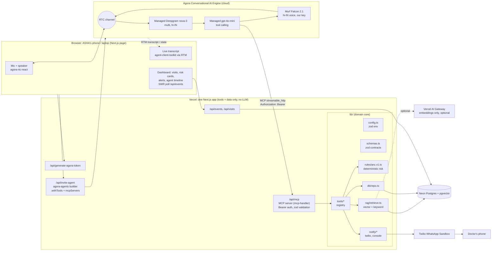
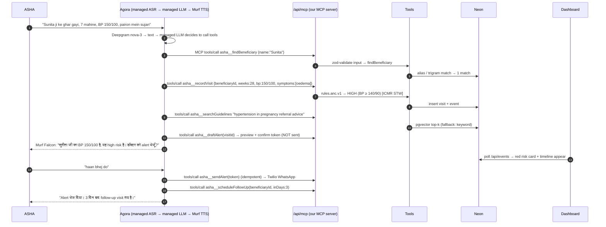
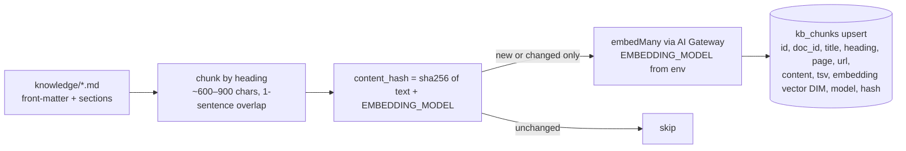
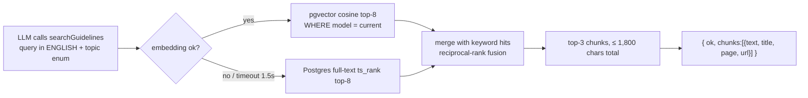

# ASHA Saathi: Architecture

> *Working name. Rename freely.*
> A Hindi/Hinglish **voice copilot for ASHA workers**. After a home visit, the ASHA speaks naturally. The agent turns that into a structured visit record, flags high-risk pregnancies with **deterministic, cited rules**, explains why using **RAG over official guidelines**, alerts the health-centre doctor on WhatsApp (after the ASHA confirms), and schedules the follow-up visit.
>
> Hackathon: Build with Agora BLR, **Track 5, "Voice AI for Bharat"**. Last verified **19–20 Nov 2026**.

> **Revision 2 (20 Nov 2026): "Option A" adopted.** Agora's **managed** `gpt-4o-mini` and **managed** Deepgram nova-3 run the conversation. Murf Falcon is TTS only, with our key (Murf has no LLM). **Our Vercel app hosts only the tools, as an MCP server** (`/api/mcp`). **Vercel AI Gateway and the custom-LLM SSE route are off the critical path** (kept as the Option B fallback, §8.1). The spike that backs this is in §8.2.
> Sources: https://docs.agora.io/en/ai/build/managed-mode.md · https://docs.agora.io/en/ai/build/tools/mcp-tools.md · https://docs.agora.io/en/ai/platform/build/tools/custom-tools.md · https://docs.agora.io/en/ai/models/tts/murf.md · https://docs.agora.io/en/ai/reference/pricing.md

**Verification legend.** Every technical claim carries one of these tags:
- ✅ **VERIFIED-CODE**: I ran it, or read it in the installed package source / cloned repo.
- ✅ **VERIFIED-DOC**: read in the official docs today.
- 🧪 **LOCAL-TEST**: needs your API keys, phone or browser. There's an exact prompt for it in `docs/LOCAL_AGENT_PROMPTS.md`, with pass/fail criteria. Nothing here is "assumed". Anything that isn't verified is a named test.

---

## 1. What the judges will see (problem → value)

ASHA workers do home visits and then fill in paper registers. High-risk signs (high blood pressure, severe anaemia, bleeding) can be missed or reported late.

**ASHA Saathi:**
1. **Initiate:** the ASHA taps one button and speaks Hindi/Hinglish.
2. **Understand:** speech → structured visit (BP, Hb, weeks, symptoms), plus the right beneficiary.
3. **Assist:** rules engine → risk level and reasons. RAG → *why* and *what to advise*, with source citations.
4. **Execute:** saves the visit, drafts the doctor alert, sends it on WhatsApp **after a spoken "haan"** (yes), and books the follow-up.
5. **Confirm & Follow Up:** spoken confirmation in Hindi (Murf Falcon). The dashboard updates live. A follow-up reminder is queued.

**Safety position (say this in the pitch):** the AI **never decides** risk. A versioned rules engine does, citing ICMR / NHM guidance. The LLM only extracts data, explains and communicates. The output is *decision support plus referral*, never a diagnosis.

---

## 2. Design principles: what makes it not brittle

| # | Principle | How it is enforced |
|---|---|---|
| P1 | **Contracts first** | One `lib/schemas.ts` with zod schemas, used by tools, DB row parsing, API bodies and UI events. A change in one place gives compile errors everywhere it matters. |
| P2 | **Everything swappable by config** | ASR, LLM model, fallback models, embedding model, TTS voice, notifier and feature flags all come from **zod-validated env** (`lib/config.ts`). It fails fast at boot with a readable error. No vendor name is hard-coded in business logic. |
| P3 | **Deterministic where it matters** | Risk = pure TypeScript rules (`lib/rules/anc.v1.ts`) with unit tests. The LLM cannot override them. |
| P4 | **Tools never throw** | Each tool returns `{ ok: true, data } \| { ok: false, code, messageHi }`, so the model can always say something sensible. |
| P5 | **Side effects are two-phase and idempotent** | `draftAlert` → (ASHA confirms by voice) → `sendAlert(token)`. The idempotency key is unique in the DB, so Agora retries or a double "haan" can never send twice. |
| P6 | **Graceful degradation** | RAG down → keyword search. Embeddings down → keyword only. Managed LLM misbehaving → switch `LLM_MODEL` to another managed model (gpt-4.1-mini, gpt-5-mini), and Option B (§8.1) is the last resort. WhatsApp down → alert shown as "pending" in the dashboard plus a console notifier. ASR bad → switch provider by env. |
| P7 | **Observable** | Every turn and tool call is written to an `events` table (turn, tool, input, output, ms, ok). The dashboard timeline reads it, which also shows judges the agentic behaviour. |
| P8 | **Stateless functions** | All state is in Postgres. Any Vercel instance can serve any turn. |
| P9 | **Model-agnostic** | The LLM is an Agora-managed model chosen by `LLM_MODEL` (gpt-4o-mini, gpt-4.1-mini, gpt-5-nano, gpt-5-mini; [source](https://docs.agora.io/en/ai/build/managed-mode.md)). Changing it is an env change. Prompts don't rely on one vendor's quirks. |

---

## 3. Stack, with verification status

| Layer | Choice | Status |
|---|---|---|
| App | **One Next.js 16 App Router app on Vercel**, started from **`AgoraIO-Conversational-AI/agent-quickstart-nextjs`** (commit `24374411`, 19 Oct 2026) | ✅ VERIFIED-CODE: cloned. It already has `/api/generate-agora-token`, `/api/invite-agent`, `/api/stop-conversation`, **`/api/chat/completions` (custom LLM, AI SDK streaming SSE)**, a transcript UI and `vercel.json`. |
| Agent control | **`agora-agents` SDK, pinned to 2.15.0** (`Agent`, `AgoraClient`, `.withStt/.withLlm/.withTts/.withTools`). The template shipped `^2.9.0`; we bumped it. | ✅ VERIFIED-CODE: `AgoraClient` builds REST auth plus RTC/RTM tokens from **App ID + App Certificate**, so no Customer ID/Secret is needed. ✅ VERIFIED-CODE (20 Nov): `withTools()`, `mcpServers`, `tools` and the managed presets are in 2.15.0 (§9). |
| TTS (mandatory) | `new MurfTTS({ key, voiceId, locale:'hi-IN', model:'falcon-2.1', sampleRate:24000, baseUrl:'wss://global.api.murf.ai/v1/speech/stream-input' })`. **Murf is TTS only (plus an STT beta) and has no LLM; in Agora it is BYOK**, so it uses our Murf key. ([source](https://docs.agora.io/en/ai/models/tts/murf.md)) | ✅ VERIFIED-CODE: the class serializes to `vendor:"murf"`, `params.api_key/base_url/voiceId/locale/model/sample_rate`. 🧪 The Hindi voice actually speaking through Agora is still a local test (P-02, and the voice half of P-04). |
| ASR | **Agora-managed Deepgram nova-3**: `new DeepgramSTT({ model:'nova-3', language:'multi' })` with **no apiKey**. Agora interaction language is set by `turnDetection.language:'hi-IN'`. The adapter (`ARES` / `Sarvam` / BYOK Deepgram) stays as the swap path. ([source](https://docs.agora.io/en/ai/build/managed-mode.md)) | ✅ VERIFIED-CODE: with no key the SDK infers the preset `deepgram_nova_3` and the session started in the 20 Nov spike. 🧪 Hinglish accuracy is P-05. |
| LLM | **Agora-managed `gpt-4o-mini`** (also managed: gpt-4.1-mini, gpt-5-nano, gpt-5-mini). In the SDK: `new OpenAI({ model:'gpt-4o-mini' })` **with no `apiKey`/`url`**, so the SDK infers the preset `openai_gpt_4o_mini` and strips model/url. ([source](https://docs.agora.io/en/ai/build/managed-mode.md)) | ✅ VERIFIED-CODE + live spike (20 Nov): the agent started and answered with **no LLM key anywhere in our project**. 🧪 "No separate LLM charge" in Console usage is a local check (P-04). |
| Tools | **MCP server on Vercel**: `mcp-handler@2.4.0` + `@modelcontextprotocol/server@^2` + `zod@^4`, served from `app/api/mcp/route.ts`. Agora calls it through `llm.mcp_servers` with `advanced_features.enable_tools:true`. ([source](https://docs.agora.io/en/ai/build/tools/mcp-tools.md)) | ✅ VERIFIED-CODE + live spike (20 Nov): managed gpt-4o-mini called our tool with `bp_sys=150, bp_dia=100` (§8.2). HTTP tools (`llm.tools`) are the alternative and were **not needed**. |
| Validation | **zod 4** | ✅ VERIFIED-CODE |
| DB + vectors | **Neon Postgres** (Vercel Marketplace) + **pgvector** | ✅ VERIFIED-DOC: pgvector is on every Neon plan, including Free. |
| Embeddings (optional) | AI Gateway `embed`/`embedMany` with `EMBEDDING_MODEL` from env. **Not on the critical path**: keyword RAG works with no embeddings. | ✅ VERIFIED-CODE: `embed`, `embedMany`, `cosineSimilarity` exist. 🧪 Free-tier eligibility of an embedding model is checked in P-10. |
| Notifier | `Notifier` interface → **Twilio WhatsApp Sandbox** \| `console` | ✅ VERIFIED-DOC: trial needs no card and includes 100 WhatsApp messages. 🧪 Real send to your phone is a local test. |
| UI | Template's Tailwind + shadcn components + Agora `agora-agent-uikit` visualizer | ✅ VERIFIED-CODE (in the template) |
| UI, optional | **Vercel UI SDK** `@ui-sdk/react` | ✅ VERIFIED-CODE: on npm as `0.1.0-beta.12`, **first published 12 Nov 2026**. A one-week-old beta, so it is **not on the critical path**. Use it only for a polish component if time allows. |
| Not used | `@json-render/*` (generative UI) | Verified to exist (v0.23.2). **Skipped on purpose.** Our UI is fed by typed events into fixed components, which is more predictable than LLM-generated layouts for a medical demo. |

---

## 4. System diagram



## 5. One turn, end to end



The model sees our tools as `<serverName>__<toolName>` (here `asha__echoVisit`). ✅ VERIFIED-CODE, from the 20 Nov spike conversation history. `allowed_tools` uses the **un-prefixed** names.

---

## 6. RAG: what, where, why

**Purpose.** RAG answers *"why is this risky and what should I tell the family?"* and free questions like *"anaemia mein kya khilayein?"* (what should she eat for anaemia?). It only uses **official text**, and returns **citations** that the UI shows as source chips.

**RAG does NOT:**
- decide risk (the rules engine does: P3);
- fetch patient history (that's a structured SQL lookup, `getBeneficiaryHistory`).

That split is what keeps answers grounded and safe.

### 6.1 Corpus (curated, small, official)

We hand-curate Markdown files in `knowledge/`, copying the relevant sections from the PDFs. That's faster and more reliable than PDF parsing, and judges can audit it. Each file has front-matter:

```md
---
id: icmr-anc-stw
title: ICMR Standard Treatment Workflow – Antenatal management
source_url: https://www.icmr.gov.in/icmrobject/uploads/STWs/1725952342_obg_antenatal_management.pdf
publisher: ICMR
lang: en
---
## High-risk criteria
...
```

Candidate sources:
- ✅ **ICMR STW, antenatal management.** It lists high-risk criteria: age > 35 or < 19, parity > 4, Hb < 7 g%, BP > 140/90 on 2 occasions 6 h apart, APH. https://www.icmr.gov.in/icmrobject/uploads/STWs/1725952342_obg_antenatal_management.pdf  (**20 Nov: this URL now returns 404.** The current official upload is https://www.icmr.gov.in/icmrobject/uploads/STWs/1771568619_ante-natalmanagementofnormalpregnancy-7.pdf, a one-page flowchart dated Dec 2025, so every citation is "page 1".)
- ✅ **NHM CHO Booklet, Maternal Health** (testing, high-risk identification, referral). https://nhm.gov.in/New_Update-2022-23/MH/GUIDELINES-%20MH/CHO_Booklet_%20Maternal_Health-English.pdf
- ✅ **PMSMA guidelines** (ASHA's role in high-risk pregnancy mobilisation). https://nhm.gov.in/images/pdf/programmes/maternal-health/guidelines/Pradhan_Mantri_Surakshit_Matritva_Abhiyan.pdf

🧪 The local agent opens each PDF and copies the exact sections into `knowledge/*.md` with page numbers (prompt P-08). **No clinical sentence goes in without a page reference.**

### 6.2 Ingestion (offline script, idempotent)



- `pnpm kb:ingest` is safe to re-run, because the hash skips unchanged chunks.
- Changing the embedding model changes the hash, so everything re-embeds automatically. The `model` column prevents mixing vectors from different models.
- `EMBEDDING_DIM` is validated against the first returned vector. On a mismatch it fails loudly with "update EMBEDDING_DIM / migrate column".

### 6.3 Retrieval (runtime, inside the `searchGuidelines` tool)



- **Cross-lingual:** the ASHA speaks Hindi and the docs are English. The tool's zod schema forces `query` to be English, so the LLM translates the query itself. No extra translation service needed.
- **Grounding rule** in the system prompt: health advice may only come from `searchGuidelines` results. If nothing relevant comes back, say *"यह जानकारी मेरे पास नहीं है, MO से पूछें।"* ("I don't have this information, ask the Medical Officer.")
- **Hybrid search** means RAG still works if the embedding quota runs out.

---

## 7. Tool layer (agentic core)

Every tool lives in `lib/tools/<name>.ts` and is registered in `lib/tools/index.ts`:

```ts
// lib/tools/define.ts: the one pattern every tool follows (MCP flavour)
import { z } from 'zod';
import { logEvent } from '@/lib/db/repo';
import type { McpServer } from '@modelcontextprotocol/server';

export type ToolResult<T> = { ok: true; data: T } | { ok: false; code: string; messageHi: string };

export function defineTool<I extends z.ZodTypeAny, O extends z.ZodTypeAny>(def: {
  name: string; description: string; input: I; output: O;
  sideEffect?: boolean; timeoutMs?: number;
  run: (input: z.infer<I>, ctx: { turnId: string; signal: AbortSignal }) => Promise<z.infer<O>>;
}) {
  return {
    name: def.name,
    register(server: McpServer, ctx: { turnId: string }) {
      server.registerTool(def.name, { description: def.description, inputSchema: def.input }, async (input) => {
        // MCP validates `input` against the zod schema before we get here (spike: bp_sys=999 → isError result)
        const t0 = Date.now();
        const signal = AbortSignal.timeout(def.timeoutMs ?? 4000);
        try {
          const data = def.output.parse(await def.run(input, { ...ctx, signal })); // our output validated too
          await logEvent({ turnId: ctx.turnId, type: 'tool', name: def.name, input, output: data, ok: true, ms: Date.now() - t0 });
          return { content: [{ type: 'text', text: JSON.stringify({ ok: true, data } satisfies ToolResult<unknown>) }] };
        } catch (e) {
          await logEvent({ turnId: ctx.turnId, type: 'tool', name: def.name, input, error: String(e), ok: false, ms: Date.now() - t0 });
          const r: ToolResult<never> = { ok: false, code: 'TOOL_FAILED', messageHi: 'यह काम अभी नहीं हो पाया।' };
          return { content: [{ type: 'text', text: JSON.stringify(r) }] };   // never throws: the model can still speak
        }
      });
    },
  };
}
```
> Tool names must match exactly between the server and `allowed_tools`, or the agent can hang ([source](https://docs.agora.io/en/ai/build/tools/mcp-tools.md)). `lib/tools/index.ts` exports `TOOL_NAMES`, and both the MCP route and the invite route read it. `turnId` is generated per request, because MCP calls carry no Agora turn ID (🧪 P-04 checks the headers Agora sends).

| Tool | Side effect | Input (zod) → output | Notes |
|---|---|---|---|
| `findBeneficiary` | – | `{ name, village? }` → `{ matches:[{id,name,village,weeks}] }` | Uses alias + `pg_trgm` similarity. With more than one match, the agent asks which. |
| `getBeneficiaryHistory` | – | `{ beneficiaryId }` → last 3 visits | Structured context, not RAG. |
| `recordVisit` | writes DB | `VisitInput` (BP, Hb?, weeks, symptoms enum[], notes) → `{ visitId, risk:{level, reasons[], rulesVersion, citations[]} }` | **Calls the rules engine internally.** The model can't skip it or fake the result. |
| `searchGuidelines` | – | `{ query (English), topic: enum }` → `{ chunks[] }` | RAG (§6) |
| `draftAlert` | writes draft | `{ visitId }` → `{ token, previewHi, to }` | Phase 1 of 2. Nothing is sent. |
| `sendAlert` | **external** | `{ token }` → `{ status, providerId }` | Phase 2. Unique `idempotency_key`. Only valid after a draft exists and less than 10 min have passed. |
| `scheduleFollowUp` | writes DB | `{ beneficiaryId, inDays (1–30), reason }` → `{ followUpId, dueDate }` | |
| `todaySummary` | – | `{}` → counts + pending follow-ups | "Aaj ka kaam?" ("What's on today?") |

**Why two-phase instead of AI SDK `needsApproval`:**
- ✅ VERIFIED-CODE: `needsApproval` exists in v6.
- But every voice turn is a *separate HTTP request from Agora*. A DB-stored draft token works across turns and instances, and survives interruptions.

**Rules engine** (`lib/rules/anc.v1.ts`) is a pure function and unit-tested:

```ts
export const RULES_VERSION = 'anc.v1';
export function assessAnc(v: VisitInput, b: Beneficiary): Risk {
  // Each rule cites its source; thresholds only from verified sources (§6.1).
  // e.g. BP ≥ 140/90 → 'high', reason 'BP_HIGH', cite icmr-anc-stw
  //      Hb < 7 → 'high', 'HB_SEVERE_ANAEMIA'
  //      age < 19 or > 35, parity > 4 → 'watch' risk factors
  //      reported bleeding (APH) → 'urgent'
}
```

✅ **Evidence extracted (20 Nov, `knowledge/RULES_EVIDENCE.md`, verbatim with page numbers).** Only the ICMR STW contains clinical numbers (BP > 140/90 on 2 occasions 6 h apart, Hb < 7, age > 35 or < 19, parity > 4) and a danger-signal list (fever, persistent vomiting, breathlessness, bleeding, decreased foetal movement at > 28 weeks, leaking fluid, severe headache / blurred vision / convulsion). The NHM CHO booklet and PMSMA state no thresholds.

**Implemented as `lib/rules/anc.v1.ts`.** Each rule carries evidence: `cited` (quote and page verified) or `pending` (not in the documents we hold, so the UI never shows a source for it). Pending rules: severe BP 160/110, anaemia below 11, swelling of face or hands. Recorded product decisions: a single reading of 140/90 or more is flagged HIGH with "repeat after 6 hours" (the source needs two readings); ">=" rather than ">"; either number triggers; the urgent-versus-high mapping of danger signs is ours. A clinician should review these before real use.

---

## 8. Tool server: `/api/mcp` (replaces the custom-LLM route)

✅ VERIFIED-CODE + live spike (20 Nov 2026). `app/api/mcp/route.ts` is built with `createMcpHandler` from `mcp-handler@2.4.0` (Vercel Labs; requires `@modelcontextprotocol/server@^2`, zod ^4.2, Node 20+). It is a stateless Streamable-HTTP handler that also serves 2025-era clients, and Agora connected with protocol `2025-03-26`.

1. **Auth.** Agora sends the headers we put in `mcp_servers[].headers`. ✅ Spike: the `authorization` header arrives, plus `mcp-protocol-version`. We check it with `timingSafeEqual` against `MCP_SHARED_SECRET`, and anything else gets a 401. Header *names* are logged, never values.
2. **Validation.** Each tool has a zod `inputSchema`. ✅ A raw `tools/call` with `bp_sys:999` returns an MCP result with `isError:true` and the message `Input validation error…`.
3. **Tools never throw** (P4, `defineTool` in §7). Side effects stay two-phase and idempotent.
4. **Timeouts.** `timeout_ms: 8000` per MCP server in the invite route. Agora's HTTP-tools doc says the default is 10 s with **no retries** ([source](https://docs.agora.io/en/ai/platform/build/tools/custom-tools.md)). We assume the same for MCP (🧪 P-04). `maxDuration = 60`, `runtime = 'nodejs'`.
5. **Latency.** Agora's `fillerWords` option covers silence while tools run. The system prompt (`instructions`, versioned in `lib/prompt.ts`) keeps replies to 1–2 sentences.
6. **No LLM code on our side.** There is no `streamText`, no SSE and no Gateway key. The model, the tool loop and the retries belong to Agora.

### 8.1 Option B (fallback, only if Option A breaks)

Keep the original design: `CustomLLM` pointing at `/api/chat/completions` (template route, hardened), with the AI SDK tool loop (`streamText` + `tool()` + `stopWhen`) and a free-tier AI Gateway model plus fallbacks. ✅ This was VERIFIED-CODE on 19 Nov with a mock model (tool call → zod → Hindi text → OpenAI SSE → `[DONE]`). It needs `AI_GATEWAY_API_KEY`, `LLM_MODEL`, `LLM_FALLBACKS`, and an auth check that accepts `Authorization: Bearer` or `api-key`. Option A does not delete the template route, so switching back is an env/invite-route change.

### 8.2 Spike evidence (20 Nov 2026)

| Check | Result |
|---|---|
| Agora accepts managed LLM + `mcp_servers` + `enable_tools` | ✅ session started (`state: RUNNING`) |
| Managed LLM calls **our** tool on Vercel prod | ✅ Vercel log: `[mcp] echoVisit bp_sys=150 bp_dia=100 ms=0` |
| Tool name the LLM uses | `asha__echoVisit` (server name `asha` + `__` + tool) |
| Our result goes back into the conversation | ✅ history: `role:tool` → `{"received":true,"bp_sys":150,"bp_dia":100}` |
| Agent reply in Hindi | ✅ "BP सफलतापूर्वक सेव कर दिया गया है।" |
| Input path | The utterance "BP ek sau pachaas by sau hai, save kar do" was injected with `session.think()` (text, no microphone) |
| Hindi spoken by **Murf** | 🧪 **pending**. No Murf key was available, so this half ran with managed MiniMax TTS. |
| Real microphone + Deepgram `multi` hearing the Hindi | 🧪 **pending** (P-04) |
| Agora Console usage shows no separate LLM charge | 🧪 **pending** (P-04) |
| Flakiness seen | 1 of 3 runs returned `404 TaskNotFound` on `think()`: the agent had exited because no human was in the channel. It does not affect real calls. |

## 9. Agent start route (`/api/invite-agent`)

Uses the verified builder chain (see `docs/verified/agent-config.mjs`; the spike version is `app/api/spike-agent/route.ts`):

```ts
const agent = new Agent({
  client: new AgoraClient({ area: Area.AP, appId, appCertificate }),   // area = API routing only
  instructions: SYSTEM_PROMPT,                                          // lib/prompt.ts
  greeting: 'नमस्ते दीदी! किसके घर visit हुई?', failureMessage: 'माफ़ कीजिए, फिर से बोलिए।', maxHistory: 16,
  turnDetection: { language: 'hi-IN', config: { end_of_speech: { mode: 'vad', vad_config: { silence_duration_ms: 640 } } } },
  advancedFeatures: { enable_rtm: true },
  parameters: { data_channel: 'rtm', enable_error_message: true, enable_metrics: true },
})
  .withTools(true)                                    // sets advanced_features.enable_tools = true
  .withStt(buildStt(config))                          // managed: DeepgramSTT({ model:'nova-3', language:'multi' }), no apiKey
  .withLlm(new OpenAI({                               // managed: NO apiKey, NO url
    model: config.LLM_MODEL,                          // 'gpt-4o-mini' | 'gpt-4.1-mini' | 'gpt-5-nano' | 'gpt-5-mini'
    greetingMessage: GREETING, failureMessage: FAIL, maxHistory: 16,
    mcpServers: [{ name: 'asha', endpoint: `${config.PUBLIC_BASE_URL}/api/mcp`, transport: 'streamable_http',
      headers: { Authorization: `Bearer ${config.MCP_SHARED_SECRET}` }, allowed_tools: [...TOOL_NAMES], timeout_ms: 8000 }],
  }))
  .withTts(new MurfTTS({ key: config.MURF_API_KEY, voiceId: config.MURF_VOICE_ID, locale: 'hi-IN',
      model: 'falcon-2.1', sampleRate: 24000, baseUrl: config.MURF_WS_URL }));
```

**Exact SDK names (✅ VERIFIED-CODE in `agora-agents@2.15.0`, read from `dist/cjs/**/*.d.ts` and `.js`):**

| Need | SDK API | Raw field it sends |
|---|---|---|
| Managed LLM / ASR | **No `credentialMode` option on `OpenAI` or `DeepgramSTT`.** Omit `apiKey` (and `url`) with a supported model and `inferLlmPreset` / `inferAsrPreset` (`agentkit/presets.js`, called from `AgentSession.js`) pick the preset and strip model/url. `AgentPresets.llm.openaiGpt4oMini = "openai_gpt_4o_mini"`, `AgentPresets.asr.deepgramNova3 = "deepgram_nova_3"`. `AgentSession` also accepts `preset: PresetInput`. | top-level `preset` |
| `credential_mode` | Exists as `credentialMode` on **some TTS vendors** (e.g. `CartesiaTTS`, `RimeTTS`, `CredentialMode.Managed`). Not on the LLM/ASR builders. The managed-mode doc's `llm.credential_mode:"managed"` is the REST name and is **not needed** through the SDK. | `credential_mode` |
| Enable tools | `Agent.withTools(enabled = true)` (also `advancedFeatures: { enable_tools: true }`) | `advanced_features.enable_tools` |
| MCP servers | `new OpenAI({ mcpServers: McpServer[] })` (`McpServersItem` is a deprecated alias). Type: `llm.mcp_servers?: Record<string, unknown>[]` | `llm.mcp_servers` |
| HTTP tools | `new OpenAI({ tools: LlmTool[] })`, requires `withTools(true)` | `llm.tools` |
| Inject a user turn (testing) | `AgentSession.think(text, { on_listening_action, on_thinking_action, on_speaking_action })`, `getHistory()` | `agents.think` |

```ts
// lib/voice/asr.ts
export function buildStt(c: Config) {
  switch (c.ASR_PROVIDER) {
    case 'deepgram': return c.DEEPGRAM_API_KEY
      ? new DeepgramSTT({ apiKey: c.DEEPGRAM_API_KEY, model: 'nova-3', language: c.DEEPGRAM_LANGUAGE })  // BYOK
      : new DeepgramSTT({ model: 'nova-3', language: c.DEEPGRAM_LANGUAGE });                            // Agora-managed (default)
    case 'ares':   return new AresSTT({ keywords: c.ASR_KEYWORDS });   // language comes from turnDetection
    case 'sarvam': return new SarvamSTT({ apiKey: c.SARVAM_API_KEY!, language: 'hi-IN' });
  }
}
```

- Semantic end-of-speech is English/Chinese only. ✅ VERIFIED-CODE: the SDK throws for other languages, so we use VAD.
- `Area.AP` routes API calls through Asia-Pacific. 🧪 Prompt P-03 measures latency against `Area.US`.
- Agora's no-code Agent Studio (`pipeline_id`) exists, but whether it can select Murf is unverified. **Decision: configure in code.** Studio is optional, for trying prompts only.

---

## 9.1 Languages: one config table, no per-language code

The whole product is **voice-only**. The ASHA taps Start/Stop, and everything else is speech. The screen only displays information.

Each ASHA has a `language` in her profile. One table in `lib/voice/languages.ts` maps it to every vendor setting, so **adding a language = adding a row**:

```ts
export const LANGUAGES = {
  'hi-IN': { turn: 'hi-IN', deepgram: 'multi', sarvam: 'hi-IN', murfLocale: 'hi-IN', murfVoice: env.MURF_VOICE_HI, greeting: 'नमस्ते दीदी! किसके घर visit हुई?' },
  'kn-IN': { turn: 'kn-IN', deepgram: 'multi', sarvam: 'kn-IN', murfLocale: 'kn-IN', murfVoice: env.MURF_VOICE_KN, greeting: '<Kannada greeting, written & checked in P-02>' },
  // ta-IN, te-IN, bn-IN, gu-IN: same shape
} as const;
```

| Layer | Indian-language support | Status |
|---|---|---|
| **Agora interaction language** (`turnDetection.language`) | The SDK accepts `hi-IN, ta-IN, te-IN, kn-IN, bn-IN, gu-IN, en-IN`, including **as a list in one session**. It **rejects `mr-IN, ml-IN, pa-IN, or-IN`** ("Invalid turnDetection.language"). | ✅ VERIFIED-CODE (`lang-test.mjs`). 🧪 Whether the *API* also rejects them is tested in P-05b. |
| **ASR: Deepgram, Agora-managed** (default; no Deepgram account) | Nova-3 multilingual lists hi, bn, ta, te, mr, kn, gu, en-IN. Monolingual adds ml, pa, as, ur. No Odia. | ✅ VERIFIED-DOC. 🧪 Streaming quality per language and managed billing are tested in P-05. |
| **ASR: Sarvam Saaras v3** (comparison / backup) | 22 Indian languages + English, auto-detect with `unknown`, code-mixed audio | ✅ VERIFIED-DOC; ₹100 free credit |
| **ASR: ARES** (Agora's own) | follows `turnDetection.language` | 🧪 P-05 |
| **LLM** | Agora-managed `gpt-4o-mini`. The prompt says: reply in the session language, Devanagari/native script, digits for numbers | 🧪 P-06 checks Hindi and Kannada |
| **TTS: Murf Falcon 2.1** | Voice-library locales: hi, bn, ta, te, mr, kn, gu, ml, or, pa, as, en-IN | ✅ VERIFIED-DOC. Voice + locale are **fixed at agent start**, so language = per session. Mid-call switching via Agora `custom_metadata.tts_params` is a stretch goal only. |
| **Rules engine / RAG** | Language-independent (numbers + English corpus; the LLM translates queries) | ✅ by design |

**Demo:** run the visit in Hindi, then switch the profile to **Kannada** (supported by Agora, Deepgram, Sarvam and Murf) and repeat it.

---

## 10. Data model (Neon)

```sql
create extension if not exists vector;  create extension if not exists pg_trgm;
create table ashas        (id uuid pk, name text, phone text, phc_name text, doctor_phone text);
create table beneficiaries(id uuid pk, asha_id uuid, name text, aliases text[], village text, phone text,
                           age int, parity int, lmp date, created_at timestamptz default now());
create table visits       (id uuid pk, beneficiary_id uuid, visited_at timestamptz, gestation_weeks int,
                           bp_sys int, bp_dia int, hb numeric(4,1), symptoms text[], notes text, transcript text,
                           risk_level text check (risk_level in ('normal','watch','high','urgent')),
                           risk_reasons jsonb, rules_version text);
create table alerts       (id uuid pk, visit_id uuid, to_phone text, preview text, status text check (status in ('draft','sent','failed')),
                           confirm_token text unique, idempotency_key text unique, provider_id text, created_at timestamptz, sent_at timestamptz);
create table followups    (id uuid pk, beneficiary_id uuid, due_date date, reason text, status text default 'pending');
create table kb_chunks    (id text pk, doc_id text, title text, heading text, page text, url text, content text,
                           tsv tsvector generated always as (to_tsvector('english', content)) stored,
                           embedding vector(1536) /* = EMBEDDING_DIM */, model text, hash text);
create table events       (id bigserial pk, turn_id text, type text, name text, payload jsonb, ok boolean, ms int,
                           created_at timestamptz default now());
```

All reads go through `db/repo.ts`, and each row is parsed with the matching zod schema (P1).

## 11. Config (`lib/config.ts`, zod-validated)

```
# Agora (mandatory)
NEXT_PUBLIC_AGORA_APP_ID=            NEXT_AGORA_APP_CERTIFICATE=
# Murf (mandatory)
MURF_API_KEY=   MURF_VOICE_ID=       MURF_WS_URL=wss://global.api.murf.ai/v1/speech/stream-input
# ASR adapter
ASR_PROVIDER=deepgram|ares|sarvam    DEEPGRAM_LANGUAGE=multi   DEEPGRAM_API_KEY=(optional; empty = Agora-managed)   SARVAM_API_KEY=(optional)
# LLM (Agora-managed, no vendor key)
LLM_MODEL=gpt-4o-mini   (gpt-4o-mini | gpt-4.1-mini | gpt-5-nano | gpt-5-mini)   MCP_SHARED_SECRET=<random 32+ chars, openssl rand -hex 24>
# RAG
EMBEDDING_MODEL=<id>  EMBEDDING_DIM=<n>  RAG_ENABLED=true  AI_GATEWAY_API_KEY=(optional: embeddings only; keyword RAG works without)
# Data + notify
DATABASE_URL=         NOTIFIER=twilio|console   TWILIO_ACCOUNT_SID=  TWILIO_AUTH_TOKEN=  TWILIO_WHATSAPP_FROM=whatsapp:+14155238886
PUBLIC_BASE_URL=https://<app>.vercel.app
```

## 12. Free-tier budget (₹0)

| Service | Free allowance | Our use |
|---|---|---|
| Agora **agent** | **First 300 agent-minutes free**, then $0.10/min ([source](https://docs.agora.io/en/ai/reference/pricing.md), [pricing](https://www.agora.io/en/pricing/)). The "10,000 free minutes" in the dashboard are **RTC** minutes, not agent minutes. | **300 agent-min is the whole test + demo budget**: keep test calls ≤ 3 min; ~40 test calls ≈ 120 min, 3 rehearsals + demo ≈ 30 min, reserve ≥ 100 min. Use `think()` text tests (no mic) where you can. |
| Murf | 100k chars | short replies, ~1k turns |
| Deepgram (ASR) + OpenAI (LLM) | Agora-managed presets: **$0 on top of the agent-minute fee** per the pricing doc | 🧪 confirm in Console usage (P-04, P-05) |
| AI Gateway | not on the critical path | optional, embeddings only. **Never buy credits**, which ends the free tier. |
| Twilio | 100 WhatsApp msgs, 30 days | demo sends only |
| Neon | 1 GB, pgvector | fine |
| Vercel Hobby | free | fine |

## 13. Failure-mode table

| Failure | Detection | Behaviour |
|---|---|---|
| Hinglish ASR poor | P-05 A/B | change `ASR_PROVIDER`, add `ASR_KEYWORDS` (beneficiary + village names) |
| Managed LLM errors or is slow | Agora `AGENT_ERROR` events + `failureMessage` | change `LLM_MODEL` to another managed model; Option B (§8.1) as the last resort |
| Model sends malformed tool args | zod `inputSchema` in the MCP server | ✅ VERIFIED-CODE (20 Nov, raw MCP call): `bp_sys:999` returns `isError:true` with `Input validation error…` and nothing is written. 🧪 The model's retry behaviour is part of P-09. |
| MCP endpoint down, slow or 401 | Agora tool timeout (`timeout_ms`, no retries) | the agent speaks its `failureMessage`; `/api/mcp` logs header names and 401s; a bad secret fails loudly in P-04 |
| Embeddings quota/timeout | 1.5 s timeout | keyword-only retrieval |
| WhatsApp fails | Twilio error | alert `status='failed'`, dashboard shows a "Retry" button, agent says so |
| Duplicate "haan" / Agora retry | unique `idempotency_key` | second send becomes a no-op returning the same status |
| Neon cold start (5 min idle) | first query slow | warm-up script before the demo |
| User interrupts mid-turn | `request.signal` aborts | DB writes are per-tool and atomic; drafts are never auto-sent |
| Template upgrade breaks something | `pnpm verify` (template script) + our tests | pin versions in lockfile |

## 14. Sources

- Agora quickstart repo: https://github.com/AgoraIO-Conversational-AI/agent-quickstart-nextjs
- Agora custom-LLM server samples: https://github.com/AgoraIO-Community/Conversational-AI-Server-Sample
- `agora-agents` npm v2.15.0 (classes read from the package): https://www.npmjs.com/package/agora-agents
- Agora custom LLM doc (Option B only): https://docs.agora.io/en/ai/platform/build/custom-model-integration/custom-llm.md
- Agora managed mode (managed LLM / ASR): https://docs.agora.io/en/ai/build/managed-mode.md
- Agora MCP tools: https://docs.agora.io/en/ai/build/tools/mcp-tools.md · HTTP tools: https://docs.agora.io/en/ai/platform/build/tools/custom-tools.md
- Agora pricing: https://www.agora.io/en/pricing/ · https://docs.agora.io/en/ai/reference/pricing.md
- `mcp-handler` 2.4.0 (Vercel Labs): https://www.npmjs.com/package/mcp-handler
- Agora Murf TTS: https://docs.agora.io/en/ai/models/tts/murf.md · Murf voices: https://murf.ai/api/docs/voices-styles/voice-library
- Deepgram code-switching: https://developers.deepgram.com/docs/multilingual-code-switching
- AI Gateway pricing: https://vercel.com/docs/ai-gateway/usage-and-pricing
- Neon pgvector: https://neon.com/docs/extensions/pgvector
- Twilio trial: https://www.twilio.com/docs/messaging/guides/how-to-work-with-your-twilio-free-trial-account-us-only
- ICMR antenatal STW: https://www.icmr.gov.in/icmrobject/uploads/STWs/1725952342_obg_antenatal_management.pdf
- Vercel UI SDK (beta): https://github.com/vercel-labs/ui · npm `@ui-sdk/react`
